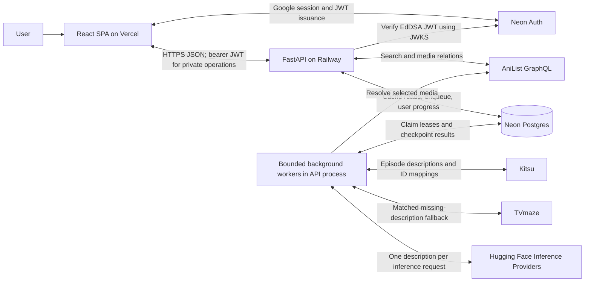

# TrueFan: technical architecture and implementation

This document describes the application code on `main` after the automated character-graph implementation, inspected on October 10, 2026. It distinguishes current behavior from future work. Deployment settings below describe the repository's hosting arrangement; they are not a fresh verification of production configuration.

## 1. Project overview

TrueFan lets users discover connected anime and explore character relationships at a selected viewing progress. It combines two graph experiences:

1. **Media universe:** AniList metadata connects individual works using provider relation types such as prequel, sequel, alternative, adaptation, and spin-off. Selecting a node opens that work's character graph. Discovery is dynamic, but bounded: it does not guarantee every installment or an authoritative watch order.
2. **Character knowledge:** Episode descriptions are processed by Hugging Face, validated, and cached in Neon. The backend returns only entities and relationships assigned to story units at or before the selected progress. The frontend renders those filtered results with React Flow.

Generated content is automatically available, labeled **experimental**, and unverified. Source-episode filtering is implemented; guaranteed spoiler safety or factual accuracy is not. A synopsis may itself contain later information, and an AI model may misinterpret it.

The fictional three-episode **Lantern Harbor** fixture remains available without external services. The automated path supports anime with resolvable episode sources. Generic media and entity types exist in the contracts, but full TV, manga, movie-unit, and game ingestion is not implemented. AniList films currently use the anime/episode contract.

## 2. Stack and repository map

| Layer | Implemented technology and purpose | Main entry points |
| --- | --- | --- |
| Browser | Vite, React, strict TypeScript, Tailwind/CSS, React Router | [`frontend/src/main.tsx`](../frontend/src/main.tsx), [`App.tsx`](../frontend/src/App.tsx) |
| Graph UI | React Flow (`@xyflow/react`), fixed grid layouts, pan/zoom and node selection | [`UniverseCanvas.tsx`](../frontend/src/components/UniverseCanvas.tsx), [`GraphCanvas.tsx`](../frontend/src/components/GraphCanvas.tsx) |
| API | FastAPI, Pydantic contracts, synchronous service functions | [`backend/app/main.py`](../backend/app/main.py), [`schemas.py`](../backend/app/schemas.py) |
| Persistence | Neon Postgres through psycopg; JSONB graph snapshots and relational progress/job metadata | [`database.py`](../backend/app/database.py), [`schema.sql`](../backend/app/schema.sql) |
| Identity | Managed Neon Auth, official React SDK/UI, Google login; PyJWT verification in FastAPI | [`frontend/src/lib/auth.ts`](../frontend/src/lib/auth.ts), [`backend/app/auth.py`](../backend/app/auth.py) |
| Discovery | AniList GraphQL search and bounded relationship traversal | [`services/anilist.py`](../backend/app/services/anilist.py) |
| Episode text | Kitsu JSON:API; TVmaze REST fallback when identity/season mapping is available | [`services/episodes.py`](../backend/app/services/episodes.py) |
| Extraction | Hugging Face Inference Providers chat-completion HTTP API, configurable instruction model | [`services/huggingface.py`](../backend/app/services/huggingface.py) |
| Generation | Postgres-backed jobs processed by bounded background threads | [`services/generation.py`](../backend/app/services/generation.py) |
| Hosting | Vercel static frontend; Railway FastAPI process; Neon managed database/Auth | [`frontend/vercel.json`](../frontend/vercel.json), [`backend/Procfile`](../backend/Procfile) |

[`backend/scripts/`](../backend/scripts/) contains standalone feasibility probes. Reports and candidate artifacts under `docs/` are research records, **not runtime graph seeds**. No production code imports `docs/data/ubw-extraction-candidates.json`.

## 3. System architecture



The browser calls FastAPI directly through `VITE_API_URL`; there is no frontend proxy or server-rendered application. It calls Neon Auth through the official SDK, but never calls Kitsu, TVmaze, Hugging Face, or Postgres directly.

FastAPI starts worker threads during its lifespan only when both `DATABASE_URL` and `HF_TOKEN` are configured. Generation runs outside ordinary request handlers. There is no Redis, Celery, separate queue server, or dedicated worker deployment. Database rows are the durable job state; threads are disposable executors.

Database connections are opened as needed with a five-second connection timeout. There is no application connection pool; a Neon pooled runtime URL can provide pooling. When workers are enabled they poll the database, so “lazy connections” does not mean the running application never accesses the database at startup.

## 4. User and data flow

### Search and universe discovery

1. The SPA starts by checking `/health` and searching with an empty query, which returns Lantern Harbor.
2. Submitting a title calls `GET /api/media/search?q=...`. AniList search returns the first page of up to ten non-adult anime entries. A matching fixture can also appear.
3. AniList IDs become internal IDs such as `anilist-19603`. Normalized metadata includes title, format, cover URL, total units, and a neutral description. Full plot synopses and character biographies are not requested for this UI.
4. Selecting an AniList search result requests its `/universe`. The backend walks typed media relations breadth-first, applying node and traversal-depth limits. Related manga may appear as metadata nodes.
5. The browser displays the bounded graph and a truncation notice when appropriate. Clicking a node selects that individual work; it does not combine knowledge across Fate routes or seasons.

AniList responses have a per-process cache with a one-hour TTL and up to 256 query entries. Universe edges are not persisted in their own Neon table. Default traversal expands the root and queued neighbors at depth one, and can include their adjacent nodes; it is not simply “one hop.”

### Opening and generating a character graph

```mermaid
sequenceDiagram
    participant UI as React frontend
    participant API as FastAPI
    participant DB as Neon Postgres
    participant Job as Background worker
    participant Source as Kitsu / TVmaze
    participant HF as HF model
    UI->>API: GET graph?progress=N
    API->>DB: Look up generated_graphs by media_id
    alt Cached document exists
        DB-->>API: Published episode snapshots
        API-->>UI: Filtered graph and generation status
    else No cached row
        API-->>UI: Empty graph; not_generated
        UI->>API: POST generation (verified bearer JWT)
        API->>DB: Check quotas; insert queued job
        API-->>UI: 202 with generation status
        Job->>DB: Claim renewable lease
        Job->>Source: Resolve identifiers and retrieve episodes
        loop Episodes in story-unit order, up to cap
            Job->>HF: One episode description
            HF-->>Job: Candidate JSON
            Job->>Job: Validate schema and source grounding
            Job->>DB: Checkpoint episode and published partial data
        end
        UI->>API: Poll graph approximately every 3 seconds
        API-->>UI: Filtered partial or completed graph
    end
```

The graph GET is read-only and never calls inference. The frontend attempts authenticated generation once per uncached media selection in the current mounted app; guests receive a sign-in message and can use Generate after signing in. New jobs require a verified user, while existing graph content is publicly readable.

### Changing progress

The implemented control is a **dropdown**, not a slider. Changing it clears the previous graph and selected profile, cancels stale requests, and fetches `/graph?progress=N`. It does not enqueue generation or save progress automatically.

The backend reconstructs graph objects from the published episode document, then [`services/graph.py`](../backend/app/services/graph.py) applies:

```text
entity.revealed_at.unit <= requested progress
edge.revealed_at.unit <= requested progress
AND both edge endpoints are visible
```

For repeated entity snapshots, it selects the latest description whose unit is visible. Future names, descriptions, evidence, and relationship labels are not sent as hidden graph objects. Generation status can still list analyzed unit numbers beyond the selected progress; those numbers are coverage metadata, not future character facts.

### Revisiting and sharing the cache

Neon is a **persistent shared cache with no automatic expiry**. Returning to a generated anime reads the existing graph without inference, and another user reuses the same graph row. Partial and failed results are also retained; revisiting alone does not retry them.

User progress is independent and keyed by user plus media. The Account panel explicitly provides **Save progress** and **Retrieve progress**. There is no automatic progress resume, autosave, saved-library screen, or persistent selected-media navigation state. Reloading starts at the fixture; selecting the anime again retrieves its cached graph.

## 5. Actual database schema

The application creates three tables in `public` via [`app/init_db.py`](../backend/app/init_db.py) and [`app/schema.sql`](../backend/app/schema.sql). It does not create or modify Neon's managed authentication tables.

### `public.user_progress`

| Column | Type / constraint | Meaning |
| --- | --- | --- |
| `user_id` | `TEXT NOT NULL`, part of primary key | Verified Neon JWT `sub` |
| `media_id` | `TEXT NOT NULL`, part of primary key | Fixture or `anilist-...` identifier |
| `completed_unit` | `INTEGER NOT NULL CHECK (completed_unit >= 0)` | Saved canonical story progress |
| `updated_at` | `TIMESTAMPTZ NOT NULL DEFAULT now()` | Last save |

The composite primary key is `(user_id, media_id)`. [`services/progress.py`](../backend/app/services/progress.py) includes the verified user ID in reads and upserts. Upper bounds are checked against media metadata in the API.

### `public.generated_graphs`

One row represents a work's shared graph and its current generation job.

| Column | Type / default | Meaning |
| --- | --- | --- |
| `media_id` | `TEXT PRIMARY KEY` | Shared cache identity |
| `media` | `JSONB NOT NULL` | Normalized media metadata snapshot |
| `document` | `JSONB NOT NULL`, `{"episodes":[]}` | Published episode results used by graph GETs |
| `working_document` | `JSONB NOT NULL`, `{"episodes":[]}` | Checkpoints, including staged refresh results |
| `status` | `TEXT NOT NULL`, `queued` | Current job/result state |
| `model` | `TEXT NOT NULL` | Configured model snapshot for the queued run |
| `episode_cap` | `INTEGER NOT NULL` | Maximum selected story units for the run |
| `requested_by` | `TEXT NOT NULL` | User who last requested generation; not exclusive graph ownership |
| `regenerating` | `BOOLEAN NOT NULL`, `false` | Whether replacement data is being staged |
| `lease_token` | nullable `TEXT` | Worker ownership token |
| `lease_until` | nullable `TIMESTAMPTZ` | Lease expiry |
| `attempts` | `INTEGER NOT NULL`, `0` | Claims/restart attempts since enqueue |
| `error` | nullable `TEXT` | User-facing generation error |
| `created_at`, `updated_at` | `TIMESTAMPTZ NOT NULL DEFAULT now()` | Creation and checkpoint timestamps |

Entities and edges are **not separate SQL tables**. Each document contains an `episodes` array. An entry stores normalized episode identity/title/provider/source URL, model ID, description SHA-256, status (`done`, `partial`, `missing`, or `failed`), character/relationship records, and applicable validation/error metadata. Full episode descriptions are excluded from persisted episode metadata; short supporting evidence remains in candidate records. Verification is exposed as `false` when runtime graph provenance is constructed.

### `public.graph_generation_requests`

| Column | Type / constraint | Meaning |
| --- | --- | --- |
| `id` | `BIGSERIAL PRIMARY KEY` | Request ledger ID |
| `user_id` | `TEXT NOT NULL` | Verified requester |
| `media_id` | `TEXT NOT NULL` | Requested work |
| `requested_at` | `TIMESTAMPTZ NOT NULL DEFAULT now()` | Rolling-day quota timestamp |

An index named `graph_generation_requests_daily` covers `requested_at`. Accepted generation requests count toward quotas, including retries/extensions/refreshes; cache hits that do not enqueue work do not add requests. There is no ledger cleanup job.

### Relationships and cache semantics

Tables share `media_id` and user-subject values logically, but there are **no SQL foreign keys** between them or to Neon Auth. There is no standalone media, episode, entity, relationship, or universe-edge table. Graph status is a text column; state choices are controlled by application logic/Pydantic, not a database enum.

Changing the model configuration does not invalidate existing graphs. Explicit regeneration is required to replace them. The cached `media` snapshot can serve details even when AniList is unavailable, but fresh search, universe discovery, and generation still depend on providers.

## 6. Episode and AI pipeline

### Provider resolution and numbering

[`services/episodes.py`](../backend/app/services/episodes.py) separates episode retrieval from inference:

- Kitsu title search finds candidates, but selection requires matching format/year and a matching AniList or MyAnimeList mapping, with conflicting IDs rejected. Ambiguous or absent matches fail instead of guessing an adaptation.
- Kitsu pagination follows validated HTTPS `kitsu.app` links, deduplicates resource IDs, and stops after ten pages. Duplicate or invalid episode numbers are rejected.
- HTML descriptions become normalized plain text. Each `Episode` has `unit`, broadcast `number`, `title`, nullable `description`, `provider`, `source_url`, and `provider_id`.
- TVmaze fills **missing descriptions on already resolved Kitsu episodes**, using a Kitsu TVDB series-and-season mapping, TVmaze ID verification, and an Animation-type check. It is not an independent fallback when Kitsu cannot resolve a work or its API fails, and it does not replace merely short nonempty descriptions.
- Empty descriptions or descriptions under eight words skip extraction. Provider failure is distinct from an episode with missing text.

UBW is an explicit catalog-numbering exception, not hardcoded story content:

| Meaning | Stored progress unit | Broadcast episode |
| --- | --- | --- |
| Not started | 0 | None |
| UBW prologue | 1 | 0 |
| First numbered episode | 2 | 1 |
| Fifth numbered episode | 6 | 5 |

For AniList `19603`, the provider validates the separate Kitsu prologue entry `9718` against MAL `27821`. Numbered episodes shift by one story unit. The default cap of six therefore includes the prologue plus episodes 1–5. This mapping is not a general solution for every anime's specials or season numbering.

### Model invocation and validation

[`services/huggingface.py`](../backend/app/services/huggingface.py) calls `https://router.huggingface.co/v1/chat/completions` with the server-only token. Default configuration is `HF_MODEL=Qwen/Qwen3-4B-Instruct-2507:nscale`; model selection lives in [`config.py`](../backend/app/config.py), not React or API handlers. A job snapshots its selected model, and every episode result retains that model ID.

Each request contains one episode description and extraction instructions, with temperature zero and a 2,000-token completion limit. It does not send future descriptions or previous episodes as context. `HF_RESPONSE_FORMAT` supports `schema` (default), `json`, or `prompt` for provider compatibility. A non-`stop` finish reason is rejected as incomplete.

Current output is `characters` and `relationships`, not every generic entity type:

- Characters have a name, optional aliases, a short description, and evidence.
- Relationships have source/target names, a concise label, evidence, and a type from `rescues`, `attacks`, `accompanies`, `informs`, `truce`, `hosts`, `commands`, or `other`.
- Strict Pydantic schemas reject extra fields and invalid records. Descriptions are limited to 180 characters and 30 words with a sentence check; labels accept at most five words, with one-word model labels expanded by the adapter.
- Checks require source-grounded names and exact evidence substrings, reject selected generic role names and unsupported protagonist claims, restrict aliases, and apply simple interaction cues and a known passive-rescue direction check.
- Explicitly named relationship endpoints can become minimal character nodes when the model omitted their character record. Unnamed people are not assigned invented identities.
- Malformed records can be discarded while retaining usable records. Empty relationship lists are valid. These lexical checks cannot establish semantic truth.

The structured-output schema omits the optional alias property from the model request to avoid an observed provider-output issue; the parser still supports grounded aliases when present.

### Turning results into a graph

[`generation.graph_data()`](../backend/app/services/generation.py) processes stored episode results in unit order. It derives stable IDs from normalized names, applies explicit aliases and conservative unambiguous short-name matching, and produces entity snapshots. Edges are deduplicated by source, target, and relationship type, retaining the first processed supporting unit.

`revealed_at.unit` and `provenance.source_unit` are assigned by the backend from the source episode, not trusted model output. They mean **first processed source support**, not a verified first reveal in the anime. Provenance also includes the source URL, original episode number/title, evidence, model ID, and `verified: false`.

Later character snapshots cannot overwrite earlier visible descriptions when the user rewinds. Relationships do not yet have end dates or a full changing-alliance model; a once-supported edge remains visible at later progress.

### Jobs, errors, retries, and cost controls

A short Postgres advisory transaction lock serializes enqueue/claim decisions. The media primary key and row locking prevent duplicate jobs for the same work. Workers claim rows with `FOR UPDATE SKIP LOCKED`, renew leases every 30 seconds, and checkpoint each episode only while their token and lease remain valid. An initial checkpoint verifies ownership before inference begins.

Default limits are two active jobs across the shared database, three accepted requests per user per rolling 24 hours, twenty globally, and six initial story units. Workers check for work approximately every five seconds when idle. Interrupted jobs resume after lease expiry and fail after three interrupted claims until explicitly retried. Successful episode checkpoints are reused.

| Operation | Behavior |
| --- | --- |
| `start` | Create a missing job; reuse any existing row without automatic regeneration |
| `retry` | Requeue eligible terminal results, retaining completed/partial work and reconsidering failed/missing episodes; completed `ready` graphs are reused |
| `extend` | Requeue when the configured episode cap exceeds the stored cap; preserve existing work |
| `refresh` | Restricted to `GENERATION_ADMIN_SUBJECT`; stage replacement data and retain the old published document unless the selected replacement episodes finish successfully |

The UI exposes Generate/Retry; extension and refresh are API operations. Raising the cap or changing the model alone does not schedule work.

Provider HTTP uses a user agent, throttling (2.1 seconds between Kitsu calls, 0.8 seconds for other providers within a process), 20-second default request timeout, and up to two retries for transient failures. Numeric `Retry-After` is honored within a bounded delay. HF uses a 60-second timeout and no automatic HTTP retry to avoid duplicate paid calls. Episode extraction failures are recorded and do not abort every other episode.

Published status is `queued`, `retrieving`, `generating`, `ready`, `partial`, `empty`, or `failed`; `not_generated` means there is no row. `partial` can mean the cap stops before the full work or some selected episodes failed. A source episode can be successfully processed yet contain no characters. Coverage is not an accuracy score.

## 7. HTTP API reference

Routes are implemented in [`backend/app/main.py`](../backend/app/main.py). Pydantic contracts live in [`schemas.py`](../backend/app/schemas.py), with generation operations in `services/generation.py`. FastAPI exposes `/docs`, `/redoc`, and `/openapi.json`.

| Method and route | Auth | Purpose / important response |
| --- | --- | --- |
| `GET /health` | Public | `{"status":"ok","mode":"demo"}`; liveness only, not database/provider readiness |
| `GET /api/media/search?q=...` | Public | `Media[]`; empty query returns fixture; query max 200 characters |
| `GET /api/media/{media_id}` | Public | Normalized `Media`, preferring cached metadata when available |
| `GET /api/media/{media_id}/universe` | Public | `{root_id, media, relationships, truncated}`; edges have `source`, `target`, `type` |
| `GET /api/media/{media_id}/graph?progress=N` | Public | Required nonnegative progress; returns filtered `GraphResponse`; above-total progress is 422 |
| `GET /api/media/{media_id}/generation` | Public | `GenerationStatus`, with no graph facts or raw descriptions |
| `POST /api/media/{media_id}/generation` | Bearer JWT | Body `{"operation":"start"}` (also retry/extend/refresh); 202 status response; demo returns 409 |
| `GET /api/me` | Bearer JWT | `{"id":"verified-subject"}` |
| `GET /api/me/progress/{media_id}` | Bearer JWT | `{media_id, progress:{unit}}` or `null` |
| `PUT /api/me/progress/{media_id}` | Bearer JWT | Body `{"unit":N}`; saves and returns this user's progress |
| `POST /api/extract` | Public | Legacy fixture-only request `{media_id, summary, source, reveal_point:{unit}}`; returns 501, no inference |
| `POST /api/ask` | Public | Legacy fixture-only request `{media_id, progress:{unit}, question}`; returns 501, no answer |

`Media` includes `id`, `title`, `type`, `progress_unit`, `total_units`, `description`, nullable `anilist_id`, `has_prologue`, nullable `cover_url`, and nullable `format`.

`GraphResponse` contains `media_id`, `progress:{unit}`, `entities`, `relationships`, `experimental`, and nullable `generation`. Entities contain `id`, `name`, `type`, `description`, `revealed_at`, and `provenance`. Edges contain `id`, endpoint IDs, `type`, optional `label`, `revealed_at`, and `provenance`.

`GenerationStatus` contains `status`, `processed_units`, `supported_units`, `episode_cap`, nullable `error`, nullable `updated_at`, and `experimental`. Counts/coverage come from the published document, so staged refresh progress does not replace the old graph's coverage.

Important errors include 401 for invalid/missing identity, 403 for unauthorized refresh, 404 for unavailable/unknown media, 422 for invalid progress/unsupported extraction type, 429 for generation quotas, 502 for provider failures, and 503 for missing generation configuration or unavailable storage/Auth keys. Error messages are intended for display without tokens or raw model responses.

## 8. Frontend architecture and authentication

| File | Responsibility |
| --- | --- |
| [`main.tsx`](../frontend/src/main.tsx) | React root, StrictMode, BrowserRouter, Auth provider; `/`, `/auth/:path`, `/account/:path`, fallback redirect |
| [`App.tsx`](../frontend/src/App.tsx) | Search, selected work/progress, universe/character view, request cancellation, polling and generation states |
| [`MediaControls.tsx`](../frontend/src/components/MediaControls.tsx) | Search form, result buttons, progress dropdown and prologue labels |
| [`UniverseCanvas.tsx`](../frontend/src/components/UniverseCanvas.tsx) | Four-column media graph with relation labels; click opens work |
| [`GraphCanvas.tsx`](../frontend/src/components/GraphCanvas.tsx) | Three-column character/entity graph, relationship labels and node selection |
| [`EntityDetails.tsx`](../frontend/src/components/EntityDetails.tsx) | Selected entity description, support point, attribution and experimental warning |
| [`AuthProvider.tsx`](../frontend/src/components/AuthProvider.tsx), [`AuthPages.tsx`](../frontend/src/components/AuthPages.tsx) | Official Google-only Neon UI and account/auth routes |
| [`AuthPanel.tsx`](../frontend/src/components/AuthPanel.tsx) | Session display, API identity verification, explicit progress save/retrieve |
| [`lib/api.ts`](../frontend/src/lib/api.ts), [`lib/types.ts`](../frontend/src/lib/types.ts) | Typed FastAPI requests, bearer token acquisition and matching frontend contracts |
| [`index.css`](../frontend/src/index.css) | Shared styling and React Flow presentation |

Universe/character navigation uses React state inside `/`, not separate media URLs. Graph nodes are not draggable or connectable; users pan, zoom, and select. There is no force-directed layout, graph editor, or generated animation pipeline.

Neon manages credentials and sessions. The frontend obtains an API JWT using `.token()`; the SDK's `X-Force-Fetch` workaround bypasses a known session-cache issue. FastAPI verifies EdDSA signatures through trusted JWKS, checks issuer/audience against the Auth URL origin, requires `exp`, `iat`, `iss`, `aud`, and a nonempty `sub`, and derives ownership from that subject. Opaque session IDs and client-selected user IDs are not accepted as identity.

Google-only UI settings do not independently disable other methods in Neon configuration. Without frontend Auth configuration, the app supports guest access to the fixture and existing cached graphs. There is no parallel password database.

## 9. Deployment and configuration

- **Vercel:** `frontend` root, Vite build (`npm run build`), `dist` output. `vercel.json` rewrites routes to `index.html`, including direct Auth/account links.
- **Railway:** `backend` root, dependencies from `requirements.txt`, Procfile starts `uvicorn app.main:app --host 0.0.0.0 --port $PORT`. API and background generation share this process.
- **Neon:** Persistent Postgres cache/progress and managed Auth on the intended branch. Apply the additive schema explicitly with `python -m app.init_db`, using a direct DB connection for setup. Runtime can use a pooled connection. Startup does not automatically apply migrations.
- **Origins:** FastAPI CORS permits the single configured frontend origin and GET/POST/PUT with Authorization/Content-Type. Neon Auth must also trust the frontend domain. These are separate settings.

### Environment variables

No secret values belong in this document or frontend code. `VITE_*` variables are public build-time values; rebuild the frontend when changing them.

| Variable | Location | Use / default |
| --- | --- | --- |
| `VITE_API_URL` | Vercel/frontend | Railway origin; local fallback `http://localhost:8000` |
| `VITE_NEON_AUTH_URL` | Vercel/frontend | Full managed Auth URL |
| `DATABASE_URL` | Railway/backend secret | Neon connection string |
| `HF_TOKEN` | Railway/backend secret | Inference Providers credential |
| `NEON_AUTH_BASE_URL` | Railway/backend | Full Auth URL; same intended branch as frontend |
| `NEON_AUTH_JWKS_URL` | Railway/backend | Optional trusted override; otherwise derived from full Auth URL |
| `FRONTEND_URL` | Railway/backend | Allowed frontend origin; default `http://localhost:3000` |
| `ANILIST_API_URL` | Railway/backend | Default `https://graphql.anilist.co` |
| `HF_MODEL` | Railway/backend | Default `Qwen/Qwen3-4B-Instruct-2507:nscale` |
| `HF_RESPONSE_FORMAT` | Railway/backend | `schema` default; also `json` or `prompt` |
| `GENERATION_EPISODE_CAP` | Railway/backend | Default 6; allowed 1–24 |
| `GENERATION_JOBS_PER_USER` | Railway/backend | Default 3 per rolling day; allowed 1–20 |
| `GENERATION_GLOBAL_DAILY_LIMIT` | Railway/backend | Default 20 per rolling day; allowed 1–200 |
| `GENERATION_MAX_CONCURRENT` | Railway/backend | Default 2; allowed 1–4 |
| `GENERATION_LEASE_SECONDS` | Railway/backend | Default 180; allowed 120–600 |
| `GENERATION_ADMIN_SUBJECT` | Railway/backend | Empty by default, disabling refresh; otherwise permitted verified subject |
| `UNIVERSE_NODE_CAP` | Railway/backend | Default 25; allowed 1–50 |
| `UNIVERSE_DEPTH` | Railway/backend | Default 1; allowed 0–2 |

Settings load through Pydantic from environment variables and local `backend/.env`. Google OAuth secrets stay in Neon configuration, and inference/database credentials stay server-side. No runtime code rewrites version-controlled JSON files.

## 10. Verification, limitations, and future work

### What has been exercised

The implementation validation recorded in [the generation guide](automated-graph-generation.md) includes 50 passing backend tests with isolated real Postgres lifecycle/concurrency tests, frontend typecheck/build/auth regression, and browser search/universe/cached-progress checks. A real UBW run cached seven characters and eight relationships through the prologue plus episodes 1–5, with one failed episode retryable. These counts demonstrate the workflow, not measured relationship accuracy or universal anime coverage. Google login was separately confirmed by the project owner.

Useful commands:

```bash
# From backend/
python -m unittest discover -s tests

# From frontend/
npm run typecheck
npm run build
node --test tests/auth-api.test.mjs
```

Four database integration tests require an explicitly configured `TRUEFAN_TEST_DATABASE_URL`; otherwise they skip. They create/remove isolated temporary schemas. This is not a Neon branch-clone test. Ordinary mocked Auth tests do not establish live OAuth success.

### Current limitations

- **Coverage:** AniList discovery is bounded and depends on metadata completeness. Search is first-page only. Kitsu matching can reject unfamiliar formats, absent mappings, or mismatched years. TVmaze is a narrow supplement, not a universal backup. Unknown episode totals fall back to one unit.
- **Accuracy and spoilers:** Descriptions omit interactions and can contain later information. Lexical evidence checks do not prove relationship meaning, direction, or true reveal timing. Metadata titles/covers and universe connections may themselves reveal information. The warning is intentional.
- **Temporal knowledge:** Work graphs stay isolated; there is no cross-route knowledge merge. Alias resolution is heuristic. Relations do not expire or model reversals, and richer facts/factions/locations are not extracted by the current runtime schema.
- **Durability and scaling:** JSONB documents are simple persistent snapshots, not a normalized graph database. Every graph request reconstructs/filter facts in Python; every checkpoint writes a document. Connections are opened per operation. Larger datasets need profiling, indexes/normalization or more selective queries, and possibly a dedicated worker queue.
- **Exactly-once execution:** Leases prevent overlapping publication, but a crash after a paid model response and before its checkpoint can cause that episode to be inferred again. There is no provider-side idempotency key or exact spend accounting.
- **Rate limits and cost:** Request quotas bound accepted jobs, not token spend. Provider throttling is per process, not coordinated across replicas. Public search/universe endpoints lack a separate per-user rate limiter. No cache expiry, eviction, refresh schedule, or ledger retention job is implemented.
- **UX:** Progress saving is manual; navigation is not deep-linked; layout is a fixed grid. Empty source data can yield an empty graph, and partial coverage is normal. The health endpoint is not a dependency readiness check.

### Planned, not implemented

Spoiler-safe Q&A, automatic saved-progress resume, saved libraries, comprehensive universe completeness, generalized special/season mapping, cross-work knowledge modes, richer entity extraction, semantic accuracy evaluation, full temporal relationship changes, automatic scheduled refresh, and production-scale ingestion infrastructure remain future improvements. The legacy `/api/ask` and `/api/extract` routes are placeholders, not alternate working AI services.

For a judge-facing explanation: **TrueFan discovers connected anime dynamically, builds an experimental character graph from episode-local descriptions, stores it once in Neon for shared reuse, and filters returned knowledge to each user's selected progress.**
